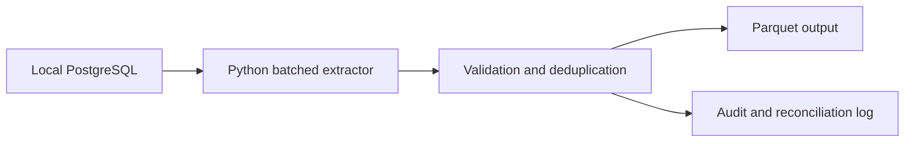
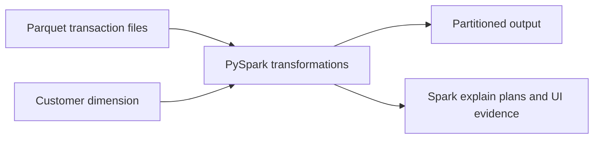
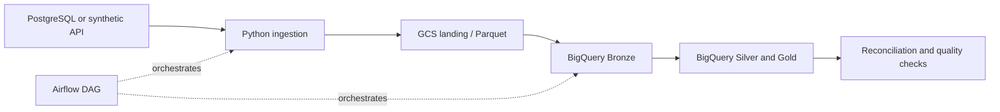

# 🚀 The Ultimate 90-Day Data Engineering Transition Roadmap — Execution Edition

> **Prepared as:** A practical, evidence-based Data Engineering mentoring and implementation plan  
> **Dates:** **Thursday, 12 November 2026 → Tuesday, 9 February 2027** (90 consecutive days)  
> **Candidate:** Working Data Analyst / aspiring Data Engineer; approximately 3 years of data experience  
> **Target roles:** Data Engineer · Cloud Data Engineer · Big Data Engineer (India)  
> **Career aspiration:** ₹12–15 LPA; **not** a promised outcome  
> **Capacity:** **1 hour minimum/day, 2 hours preferred/day** (~90–150 hours across the program)  
> **Primary stack:** Linux · PostgreSQL/SQL · Python · Git · Docker · PySpark · Airflow · GCP/BigQuery  
> **Secondary exposure:** AWS mappings · Delta Lake · dbt/Kafka concepts if time allows

> **Historical reference:** This document intentionally follows the **10-section, detailed weekly-goal, daily-schedule, practice-task, deliverable, revision and portfolio-project format** of the June 2026 Claude-generated roadmap. It is a **new plan**, recalibrated to your November 2026 baseline and available time. The old roadmap is a plan, not proof that its exercises were completed.

---

## SECTION 1 — Independent Gap Analysis & Strategic Valuation

### 1.1 First-principles profile evaluation

You are **not starting from zero**. Your professional experience includes SQL, PostgreSQL, Python-assisted ETL, GCS, BigQuery Bronze/Silver/Gold pipelines, incremental loads, reconciliation and CMEK work. However, **work exposure is not equivalent to verified independent implementation**. The goal is to reproduce the reasoning and code from a blank editor and troubleshoot failures without copying answers.

### 1.2 Diagnostic evidence (12 November 2026)

| Area | Evidence | Assessment | Priority |
|---|---|---|---|
| SQL cardinality | Correctly answered 5 activity logs × 3 payments = 15 rows | Basic join multiplication recognized; explanation and robust SQL need testing | High |
| SQL windowing | Mentioned `ROW_NUMBER` and descending order | Partial; partitioning and left-join behavior unverified | High |
| Python | Lists/dicts partly explained; generator confused with executors | Fundamentals and independent code require assessment | **Critical** |
| ETL restart | Suggested UPSERT and logs | Good instinct; idempotency, checkpoints and transaction boundaries unverified | High |
| Linux/cron | Correctly suggested logs and environment/package differences | Good starting reasoning | Medium |
| Linux disk | Answered `ps aux` for disk-full error | Need `df -h`, `df -i`, `du -sh`, `find` and safe cleanup practice | **Critical** |
| Spark | Shuffle and skew not understood | Begin with architecture and simple diagrams before tuning | **Critical** |
| Airflow | Identified duplicates on retry | Correct risk; must implement retry-safe DAG | High |
| BigQuery CMEK | Identified BigQuery service agent and key permissions | Useful production intuition; validate exact roles/scopes | Medium |
| Reconciliation | Suggested row counts and sums | Good foundation; need key-level anti-joins, exceptions and guarantees | High |
| Docker networking | Not attempted | Learn service DNS, localhost and port mapping | High |

**Written reasoning baseline:** **56/120 = 46.7% (≈47/100)**. The previous informal 55/100 figure was not the normalized arithmetic score; **47/100 is the baseline used here**. Coding assessment **pending**. No skill is marked mastered merely from this quiz.

### 1.3 High-ROI focus and hidden risks

1. **Independent Python coding** before advanced orchestration: generators, dictionaries, reusable functions, file handling, exceptions, tests.
2. **Linux troubleshooting**: distinguish disk, inode, memory, CPU, permission and cron environment failures.
3. **Distributed processing fundamentals**: driver, executors, partitions, shuffle, skew, Spark UI.
4. **Correctness before speed**: zero missing payments, no accidental duplicate inserts, deterministic replay and reconciliation.
5. **Build-first discipline**: tutorials are supporting material, not deliverables.
6. **Avoid fabricated results**: never claim 10M records/day, 35% savings, or a 9/10 readiness score without measured evidence.

### 1.4 Success definition

At the end of 90 days, the desired evidence is **three reproducible projects**, clear technical explanations, tests, documented failures/recoveries and scored interview practice. Job readiness and salary outcomes depend on the demonstrated work and hiring market, not calendar completion.

---

## SECTION 2 — Calendar-Based 90-Day Roadmap (1–2 Hours Daily)

### 2.1 Daily study cadence

| Time available | Concepts | Independent implementation | Testing/debugging | Notes + Git commit |
|---|---:|---:|---:|---:|
| **2 hours (preferred)** | 20 min | 70 min | 20 min | 10 min |
| **1 hour (minimum)** | 10 min | 35 min | 10 min | 5 min |

**Rules:** No automatic checkmarks. Complete means runnable code or written proof + tests + a clear explanation. Every seventh day is a review/assessment. If a day is missed, record it honestly and replan rather than backdating completion. Weekend time can be used for catch-up, but the plan does not assume 5–6-hour weekends.

### 2.2 Weekly objectives and checkpoints

| Week | Dates | Focus | End-of-week proof |
|---|---|---|---|
| 1 | Nov 12–18 | Diagnostic + Linux | Payment script and terminal troubleshooting |
| 2 | Nov 19–25 | SQL + PostgreSQL | Correct SQL, query plans, reconciliation |
| 3 | Nov 26–Dec 2 | Python foundations | Modular scripts and tests |
| 4 | Dec 3–9 | **Project 1** Python/Postgres ETL | Retry-safe batch pipeline |
| 5 | Dec 10–16 | Git + Docker | Reproducible local environment |
| 6 | Dec 17–23 | Spark core | DataFrame jobs + execution plans |
| 7 | Dec 24–30 | **Project 2** Spark optimization | Measured skew/shuffle investigation |
| 8 | Dec 31–Jan 6 | Airflow | Idempotent DAG and recovery test |
| 9 | Jan 7–13 | GCP + BigQuery | Load, optimize and reconcile synthetic data |
| 10 | Jan 14–20 | Architecture + AWS concepts | Design trade-off documents |
| 11 | Jan 21–27 | Delta + reliability | MERGE, data quality and replay tests |
| 12 | Jan 28–Feb 3 | **Project 3** GCP capstone | End-to-end demonstrable pipeline |
| 85–90 | Feb 4–9 | Interview + portfolio | Final practical and job-readiness review |

### 2.3 Exact day-by-day schedule

Each row defines the **day, date, focus, independent hands-on assignment and expected evidence file**. The final column is intentionally unchecked.


### WEEK 01 — Linux foundations and baseline

| Day / Date | Focus | Independent implementation | Evidence / deliverable | Done |
|---|---|---|---|:---:|
| 01 · 12 Nov 2026 | **Baseline coding assessment** | Write payment deduplication and null-handling script without pandas | `assessments/day-01/payment_validation.py` | ☐ |
| 02 · 13 Nov 2026 | **Linux filesystem** | Navigate, create, move and inspect directories; document absolute vs relative paths | `linux/day-02-filesystem.md` | ☐ |
| 03 · 14 Nov 2026 | **Files and text tools** | Use cat, less, head, tail, grep, find, sort, uniq on sample ETL logs | `linux/day-03-log-analysis.sh` | ☐ |
| 04 · 15 Nov 2026 | **Permissions and users** | Practise chmod, chown concepts, umask and executable scripts | `linux/day-04-permissions.md` | ☐ |
| 05 · 16 Nov 2026 | **Processes and resources** | Investigate ps, top, free, uptime, kill and disk usage df/du | `linux/day-05-resource-check.sh` | ☐ |
| 06 · 17 Nov 2026 | **Shell scripting** | Build argument-driven script with exit codes, variables and error handling | `linux/day-06-healthcheck.sh` | ☐ |
| 07 · 18 Nov 2026 | **Weekly Linux assessment** | Diagnose disk-full and cron failures; review independent coding | `assessments/week-01/README.md` | ☐ |

### WEEK 02 — SQL and PostgreSQL engineering

| Day / Date | Focus | Independent implementation | Evidence / deliverable | Done |
|---|---|---|---|:---:|
| 08 · 19 Nov 2026 | **Join cardinality** | Reproduce 5 logs × 3 payments and explain row multiplication | `sql/day-08-join-cardinality.sql` | ☐ |
| 09 · 20 Nov 2026 | **Window functions** | Latest payment per lead using ROW_NUMBER and LEFT JOIN | `sql/day-09-latest-payment.sql` | ☐ |
| 10 · 21 Nov 2026 | **Advanced SQL** | Practise CTEs, conditional aggregation and deduplication | `sql/day-10-advanced.sql` | ☐ |
| 11 · 22 Nov 2026 | **PostgreSQL indexes** | Create indexes; compare EXPLAIN ANALYZE plans | `sql/day-11-explain.md` | ☐ |
| 12 · 23 Nov 2026 | **Transactions** | Demonstrate BEGIN, COMMIT, ROLLBACK and constraints | `sql/day-12-transactions.sql` | ☐ |
| 13 · 24 Nov 2026 | **Reconciliation SQL** | Compare source and destination counts, sums, nulls, IDs | `sql/day-13-reconciliation.sql` | ☐ |
| 14 · 25 Nov 2026 | **Weekly SQL assessment** | Solve an unseen payments-and-activity-log scenario | `assessments/week-02/README.md` | ☐ |

### WEEK 03 — Python foundations for independent ETL

| Day / Date | Focus | Independent implementation | Evidence / deliverable | Done |
|---|---|---|---|:---:|
| 15 · 26 Nov 2026 | **Python collections** | Implement lists, dicts and sets for payment processing | `python/day-15-collections.py` | ☐ |
| 16 · 27 Nov 2026 | **Functions and modules** | Refactor validation into testable functions and modules | `python/day-16-functions.py` | ☐ |
| 17 · 28 Nov 2026 | **Iterators and generators** | Stream synthetic rows with yield; explain memory use | `python/day-17-generators.py` | ☐ |
| 18 · 29 Nov 2026 | **Files and exceptions** | Read CSV/JSON; handle malformed records with exceptions | `python/day-18-files.py` | ☐ |
| 19 · 30 Nov 2026 | **Logging and configuration** | Add structured logs, environment configuration and exit codes | `python/day-19-logging.py` | ☐ |
| 20 · 01 Dec 2026 | **Unit testing** | Write pytest tests for duplicates, nulls and invalid amounts | `python/day-20-tests.py` | ☐ |
| 21 · 02 Dec 2026 | **Weekly Python assessment** | Build a small independent CSV-to-clean-CSV pipeline | `assessments/week-03/README.md` | ☐ |

### WEEK 04 — Project 1 — PostgreSQL to Python ETL

| Day / Date | Focus | Independent implementation | Evidence / deliverable | Done |
|---|---|---|---|:---:|
| 22 · 03 Dec 2026 | **Project 1 design** | Define source schema, target schema, failure modes and acceptance tests | `projects/01-python-postgres-etl/README.md` | ☐ |
| 23 · 04 Dec 2026 | **PostgreSQL extraction** | Extract rows in bounded batches using a cursor | `projects/01-python-postgres-etl/extract.py` | ☐ |
| 24 · 05 Dec 2026 | **Validation and transform** | Validate schema, types, nulls and duplicate IDs | `projects/01-python-postgres-etl/transform.py` | ☐ |
| 25 · 06 Dec 2026 | **Load and idempotency** | Implement upsert and restart-safe batch handling | `projects/01-python-postgres-etl/load.py` | ☐ |
| 26 · 07 Dec 2026 | **Checkpoint and retry** | Persist watermark/checkpoint and retry transient errors | `projects/01-python-postgres-etl/checkpoint.py` | ☐ |
| 27 · 08 Dec 2026 | **Reconciliation and tests** | Compare counts, amounts and IDs; test restart scenarios | `projects/01-python-postgres-etl/tests/` | ☐ |
| 28 · 09 Dec 2026 | **Project 1 review** | Run end-to-end demo, record failures and improvements | `projects/01-python-postgres-etl/RESULTS.md` | ☐ |

### WEEK 05 — Git, Docker and engineering hygiene

| Day / Date | Focus | Independent implementation | Evidence / deliverable | Done |
|---|---|---|---|:---:|
| 29 · 10 Dec 2026 | **Git fundamentals** | Practise branches, commits, diffs, merge and revert | `git/day-29-workflow.md` | ☐ |
| 30 · 11 Dec 2026 | **Repository quality** | Add .gitignore, requirements and setup instructions | `projects/01-python-postgres-etl/README.md` | ☐ |
| 31 · 12 Dec 2026 | **Docker fundamentals** | Build and run a Python ETL image | `docker/day-31/Dockerfile` | ☐ |
| 32 · 13 Dec 2026 | **Docker networking** | Connect container to PostgreSQL service, not localhost | `docker/day-32/compose.yaml` | ☐ |
| 33 · 14 Dec 2026 | **Environment and secrets** | Use environment variables and example config; exclude credentials | `docker/day-33/.env.example` | ☐ |
| 34 · 15 Dec 2026 | **CI and code quality** | Add lint/test commands and a simple GitHub Actions workflow | `.github/workflows/tests.yml` | ☐ |
| 35 · 16 Dec 2026 | **Weekly integration assessment** | Clone and run Project 1 from a clean environment | `assessments/week-05/README.md` | ☐ |

### WEEK 06 — Spark core concepts

| Day / Date | Focus | Independent implementation | Evidence / deliverable | Done |
|---|---|---|---|:---:|
| 36 · 17 Dec 2026 | **Spark architecture** | Explain driver, executor, job, stage, task and partition | `spark/day-36-architecture.md` | ☐ |
| 37 · 18 Dec 2026 | **DataFrames and schemas** | Read CSV/Parquet with explicit schemas | `spark/day-37-dataframes.py` | ☐ |
| 38 · 19 Dec 2026 | **Transformations and actions** | Practise select, filter, withColumn, lazy evaluation | `spark/day-38-transformations.py` | ☐ |
| 39 · 20 Dec 2026 | **Spark joins** | Implement joins and inspect physical plans | `spark/day-39-joins.py` | ☐ |
| 40 · 21 Dec 2026 | **Shuffle and partitioning** | Explain groupBy shuffle; inspect partitions and exchange | `spark/day-40-shuffle.md` | ☐ |
| 41 · 22 Dec 2026 | **Aggregations and windows** | Implement grouped metrics and latest-event logic | `spark/day-41-windows.py` | ☐ |
| 42 · 23 Dec 2026 | **Weekly Spark assessment** | Build a small Spark batch transform without copying a solution | `assessments/week-06/README.md` | ☐ |

### WEEK 07 — Project 2 — Spark performance

| Day / Date | Focus | Independent implementation | Evidence / deliverable | Done |
|---|---|---|---|:---:|
| 43 · 24 Dec 2026 | **Project 2 design** | Create skewed transaction dataset and define expected outputs | `projects/02-pyspark-processing/README.md` | ☐ |
| 44 · 25 Dec 2026 | **Data skew diagnosis** | Measure hot keys and explain straggler tasks | `projects/02-pyspark-processing/skew_analysis.py` | ☐ |
| 45 · 26 Dec 2026 | **Join strategies** | Compare broadcast join and sort-merge join plans | `projects/02-pyspark-processing/joins.py` | ☐ |
| 46 · 27 Dec 2026 | **Partition tuning** | Experiment with repartition/coalesce and shuffle partitions | `projects/02-pyspark-processing/partitioning.py` | ☐ |
| 47 · 28 Dec 2026 | **Skew mitigation** | Try salting or pre-aggregation; document trade-offs | `projects/02-pyspark-processing/skew_fix.py` | ☐ |
| 48 · 29 Dec 2026 | **Spark UI evidence** | Capture plans and task metrics without fabricated speedups | `projects/02-pyspark-processing/PERFORMANCE.md` | ☐ |
| 49 · 30 Dec 2026 | **Project 2 review** | Verify correctness before and after tuning | `projects/02-pyspark-processing/RESULTS.md` | ☐ |

### WEEK 08 — Airflow orchestration

| Day / Date | Focus | Independent implementation | Evidence / deliverable | Done |
|---|---|---|---|:---:|
| 50 · 31 Dec 2026 | **Airflow architecture** | Explain scheduler, DAG, task instance and metadata DB | `airflow/day-50-architecture.md` | ☐ |
| 51 · 01 Jan 2027 | **First DAG** | Create extract-transform-load DAG with dependencies | `airflow/day-51-etl_dag.py` | ☐ |
| 52 · 02 Jan 2027 | **Scheduling and catchup** | Test logical dates, schedules, catchup and backfills | `airflow/day-52-scheduling.md` | ☐ |
| 53 · 03 Jan 2027 | **Retries and idempotency** | Simulate task failure after load; prevent duplicates | `airflow/day-53-retries.py` | ☐ |
| 54 · 04 Jan 2027 | **TaskFlow and XCom** | Pass small metadata; avoid passing datasets via XCom | `airflow/day-54-taskflow.py` | ☐ |
| 55 · 05 Jan 2027 | **Monitoring and alerts** | Add failure callbacks, logs and runbook | `airflow/day-55-runbook.md` | ☐ |
| 56 · 06 Jan 2027 | **Weekly Airflow assessment** | Debug a broken DAG and demonstrate safe rerun | `assessments/week-08/README.md` | ☐ |

### WEEK 09 — GCP and BigQuery engineering

| Day / Date | Focus | Independent implementation | Evidence / deliverable | Done |
|---|---|---|---|:---:|
| 57 · 07 Jan 2027 | **GCP architecture** | Map IAM, GCS, BigQuery, KMS and service identities | `gcp/day-57-architecture.md` | ☐ |
| 58 · 08 Jan 2027 | **GCS and Parquet** | Upload partitioned Parquet and validate objects | `gcp/day-58-gcs.md` | ☐ |
| 59 · 09 Jan 2027 | **BigQuery SQL** | Practise partitioning, clustering and query cost inspection | `gcp/day-59-bigquery.sql` | ☐ |
| 60 · 10 Jan 2027 | **Incremental pipelines** | Design watermarks, late arrivals and merge semantics | `gcp/day-60-incremental.sql` | ☐ |
| 61 · 11 Jan 2027 | **CMEK and IAM** | Explain KMS key, service agent and access failures | `gcp/day-61-cmek.md` | ☐ |
| 62 · 12 Jan 2027 | **Quality and observability** | Implement row-count, sum and missing-ID checks | `gcp/day-62-quality.sql` | ☐ |
| 63 · 13 Jan 2027 | **Weekly GCP assessment** | Design and troubleshoot a PostgreSQL-to-BQ load | `assessments/week-09/README.md` | ☐ |

### WEEK 10 — Architecture and AWS comparison

| Day / Date | Focus | Independent implementation | Evidence / deliverable | Done |
|---|---|---|---|:---:|
| 64 · 14 Jan 2027 | **Pipeline design** | Draw batch pipeline with failure and recovery paths | `architecture/day-64-batch.md` | ☐ |
| 65 · 15 Jan 2027 | **Data modelling** | Design facts, dimensions, SCD choices and grain | `architecture/day-65-model.md` | ☐ |
| 66 · 16 Jan 2027 | **Scalability** | Estimate data volume, throughput and bottlenecks | `architecture/day-66-capacity.md` | ☐ |
| 67 · 17 Jan 2027 | **Reliability** | Define idempotency, SLAs, retries, DLQ concepts | `architecture/day-67-reliability.md` | ☐ |
| 68 · 18 Jan 2027 | **GCP to AWS mapping** | Compare GCS/S3, BigQuery/Redshift, Dataproc/EMR | `aws/day-68-service-mapping.md` | ☐ |
| 69 · 19 Jan 2027 | **Security and cost** | Threat model service identities, secrets and spend | `architecture/day-69-security-cost.md` | ☐ |
| 70 · 20 Jan 2027 | **Weekly design assessment** | Present a 10-minute architecture review | `assessments/week-10/README.md` | ☐ |

### WEEK 11 — Delta Lake and production reliability

| Day / Date | Focus | Independent implementation | Evidence / deliverable | Done |
|---|---|---|---|:---:|
| 71 · 21 Jan 2027 | **Lakehouse concepts** | Explain Parquet versus Delta transaction log | `delta/day-71-concepts.md` | ☐ |
| 72 · 22 Jan 2027 | **Delta operations** | Practise MERGE, updates and deletes in a local example | `delta/day-72-merge.py` | ☐ |
| 73 · 23 Jan 2027 | **Schema evolution** | Test compatible and breaking schema changes | `delta/day-73-schema.md` | ☐ |
| 74 · 24 Jan 2027 | **Data quality** | Define freshness, completeness, uniqueness and validity | `delta/day-74-quality.py` | ☐ |
| 75 · 25 Jan 2027 | **Observability** | Track run IDs, row counts, errors and duration | `delta/day-75-observability.md` | ☐ |
| 76 · 26 Jan 2027 | **Incident response** | Write runbook for duplicate loads and missing data | `delta/day-76-incident-runbook.md` | ☐ |
| 77 · 27 Jan 2027 | **Weekly reliability assessment** | Recover a deliberately broken incremental load | `assessments/week-11/README.md` | ☐ |

### WEEK 12 — Project 3 — GCP end-to-end capstone

| Day / Date | Focus | Independent implementation | Evidence / deliverable | Done |
|---|---|---|---|:---:|
| 78 · 28 Jan 2027 | **Capstone design** | Define PostgreSQL→Python→GCS→BQ→Airflow architecture | `projects/03-gcp-end-to-end/README.md` | ☐ |
| 79 · 29 Jan 2027 | **Source extraction** | Build configurable incremental PostgreSQL extractor | `projects/03-gcp-end-to-end/extract.py` | ☐ |
| 80 · 30 Jan 2027 | **GCS landing** | Write validated Parquet with deterministic object names | `projects/03-gcp-end-to-end/landing.py` | ☐ |
| 81 · 31 Jan 2027 | **BigQuery modelling** | Load staging and build curated target with MERGE | `projects/03-gcp-end-to-end/sql/` | ☐ |
| 82 · 01 Feb 2027 | **Airflow integration** | Orchestrate and safely retry the full pipeline | `projects/03-gcp-end-to-end/dags/` | ☐ |
| 83 · 02 Feb 2027 | **Reconciliation and tests** | Check source-target IDs, counts and sums; test failures | `projects/03-gcp-end-to-end/tests/` | ☐ |
| 84 · 03 Feb 2027 | **Capstone demonstration** | Document setup, architecture, evidence and limitations | `projects/03-gcp-end-to-end/RESULTS.md` | ☐ |

### DAYS 85–90 — Final portfolio and interview readiness

| Day / Date | Focus | Independent implementation | Evidence / deliverable | Done |
|---|---|---|---|:---:|
| 85 · 04 Feb 2027 | **Portfolio cleanup** | Make all three project READMEs runnable and redact secrets | `progress/day-85-portfolio-review.md` | ☐ |
| 86 · 05 Feb 2027 | **SQL and Python mock** | Solve unseen SQL and Python tasks under time limit | `interviews/day-86-sql-python.md` | ☐ |
| 87 · 06 Feb 2027 | **Spark and Airflow mock** | Explain shuffle/skew, DAG retries and debugging | `interviews/day-87-spark-airflow.md` | ☐ |
| 88 · 07 Feb 2027 | **Cloud and system design mock** | Design reliable payment pipeline and defend choices | `interviews/day-88-system-design.md` | ☐ |
| 89 · 08 Feb 2027 | **End-to-end practical exam** | Fix injected pipeline failure; prove no data loss | `assessments/final-practical/README.md` | ☐ |
| 90 · 09 Feb 2027 | **Final review and next steps** | Score evidence, identify remaining gaps and plan applications | `progress/day-90-final-review.md` | ☐ |

---

## SECTION 3 — Technology Depth Matrix & Stopping Rules

| Technology | Required depth | Stop when you can… | Defer for now |
|---|---|---|---|
| Linux | Paths, permissions, shell, `df`/`du`, `top`, cron, logs, SSH concepts | Diagnose a failed scheduled ETL from terminal evidence | Kernel internals, advanced networking |
| SQL/PostgreSQL | Joins, windows, CTEs, indexes, `EXPLAIN ANALYZE`, transactions, reconciliation | Write latest-per-lead query and prove no payments lost | Exotic database internals |
| Python | Lists/dicts/sets/generators, modules, exceptions, typing, logging, `pytest`, cursors | Build ETL without pandas and then a tested DB extractor | Metaclasses, advanced async |
| Git/Docker | Branching, commits, Dockerfile, Compose, service DNS, env files | Run Postgres + ETL locally from README | Kubernetes administration |
| PySpark | DataFrames, schemas, joins, windows, shuffle, skew, AQE, Spark UI | Explain and measure a slow join and apply an appropriate fix | Catalyst source code, Scala internals |
| Airflow | DAGs, scheduling, TaskFlow, retries, backfills, XCom metadata | Retry a failed DAG without duplicate payments | Custom executors |
| GCP/BigQuery | IAM/CMEK, GCS, partitioning, clustering, MERGE, INFORMATION_SCHEMA, costs | Load and reconcile synthetic payments; explain permissions | Deep GKE/VPC administration |
| Architecture | Batch design, data contracts, failure recovery, trade-offs | Defend an end-to-end payment pipeline design | Huge-scale hypothetical systems without assumptions |
| AWS | S3/Glue/EMR/Redshift/Step Functions mappings | Compare trade-offs against GCP choices | Production AWS build unless time permits |
| Delta Lake | ACID, transaction log, MERGE, SCD2, compaction | Demonstrate safe upsert and replay | Advanced proprietary optimizations |
| Kafka/dbt | Conceptual awareness; optional hands-on | Explain use cases and trade-offs | Full streaming project before core projects pass |

---

## SECTION 4 — High-ROI Resources and Study Method

### 4.1 Official documentation (primary)

- [Python Tutorial](https://docs.python.org/3/tutorial/) · [pytest](https://docs.pytest.org/) · [PostgreSQL](https://www.postgresql.org/docs/)
- [GNU Coreutils](https://www.gnu.org/software/coreutils/manual/) · [Bash](https://www.gnu.org/software/bash/manual/) · [Docker](https://docs.docker.com/)
- [Apache Spark / PySpark](https://spark.apache.org/docs/latest/api/python/) · [Spark SQL performance tuning](https://spark.apache.org/docs/latest/sql-performance-tuning.html)
- [Apache Airflow](https://airflow.apache.org/docs/) · [Astronomer Learn](https://www.astronomer.io/docs/learn/)
- [BigQuery documentation](https://cloud.google.com/bigquery/docs) · [Cloud KMS](https://cloud.google.com/kms/docs) · [Cloud Storage](https://cloud.google.com/storage/docs)
- [Delta Lake](https://docs.delta.io/) · [AWS architecture](https://docs.aws.amazon.com/)

### 4.2 Supplementary practice

- [DataLemur](https://datalemur.com/) and [StrataScratch](https://www.stratascratch.com/) for SQL.
- [DataTalksClub Data Engineering Zoomcamp](https://github.com/DataTalksClub/data-engineering-zoomcamp) for selected labs, **not** as an extra full course.
- TrendyTech / Sumit Mittal for Spark explanations; Marc Lamberti for Airflow explanations.
- *Designing Data-Intensive Applications* for system-design intuition (selected chapters only).

### 4.3 Learning protocol

**Understand → Predict → Implement → Break → Debug → Test → Explain → Commit.** Try for 20 minutes before asking for a hint. Record the actual error, your hypothesis and the eventual root cause. Never upload employer data, credentials, internal code or sensitive architecture; use synthetic data.

---

## SECTION 5 — Enterprise-Style Portfolio Projects

### 5.1 Project 1 — Reliable PostgreSQL → Python ETL → Parquet

**Business problem:** Ingest a synthetic payments table reliably without losing or duplicating payment IDs, including restarts and late arrivals.



**Build in days 22–28; harden in days 29–35.** Use batched cursor reads, config, structured logs, exception handling, idempotent output, tests, counts and amount reconciliation. Include a deliberate failure after partial progress and prove safe rerun.

**Required evidence:** `README.md`, executable source, `requirements.txt`, sample synthetic input/schema, tests, run instructions, one failure/recovery transcript, reconciliation results. Do **not** claim exactly-once delivery merely because you used UPSERT.

**Interview prompts:** What if the process crashes after writing but before checkpointing? What is the difference between at-least-once processing and idempotent writes? How do you prove no payment IDs are missing?

### 5.2 Project 2 — PySpark Batch Processing and Performance Investigation

**Business problem:** Process synthetic transaction/activity logs and detect expensive joins, skewed keys and unnecessary shuffles.



**Build in days 43–49.** Demonstrate schemas, filters, joins, windows, aggregation, repartitioning and skew. Capture explain plans and measured timings for baseline versus changed approach; document dataset size and hardware. Avoid claiming a speedup if measurements are inconclusive.

**Required evidence:** runnable Spark script, data generator, plan screenshots/text, measurement table, correctness checks, explanation of shuffle and skew.

**Interview prompts:** Why does a `groupBy` shuffle? When is broadcast appropriate? Why can a single customer with 70% of transactions cause a straggler task?

### 5.3 Project 3 — GCP End-to-End Batch Warehouse Capstone

**Business problem:** Land synthetic payment events, transform and load them into an auditable BigQuery warehouse with safe reruns.



**Build in days 78–84.** Use least-privilege IAM where feasible, partitioning/clustering where justified, incremental `MERGE`, monitoring and key-level reconciliation. Cloud costs must be controlled; a local mock plus documented cloud execution is acceptable if budget blocks a full deployment, but state clearly what actually ran.

**Required evidence:** architecture, sanitized commands/configuration, DAG, SQL, tests, sample outputs, replay demonstration, permission troubleshooting notes, cost/limitations note.

**Interview prompts:** How would you prevent missing payments? Why choose GCS as a landing layer? How would a CMEK permission failure be diagnosed? How do you backfill yesterday's data safely?

### 5.4 Project acceptance gate

- [ ] Code can be run using documented commands.
- [ ] No secrets or proprietary data in repository.
- [ ] Synthetic test data and expected results included.
- [ ] Duplicate/missing/null handling defined and tested.
- [ ] At least one intentional failure and recovery demonstrated.
- [ ] Reconciliation output attached.
- [ ] Limitations and actual measurements disclosed.
- [ ] Can explain design choices without notes.

---

## SECTION 6 — Targeted Interview Preparation

### 6.1 SQL

Latest row per entity, many-to-many joins, deduplication, window functions, anti-joins, transaction boundaries, index trade-offs, query plans. **Weekly:** one unseen query solved from a blank editor.

### 6.2 Python

Collections, generators versus lists, functions, modules, exceptions, cursor batching, testing, logging, complexity. **Weekly:** one small code exercise without pandas or copied code.

### 6.3 PySpark

Driver/executor architecture, lazy evaluation, narrow/wide transformations, shuffle, skew, broadcast, partitioning, Spark UI and AQE. **Weeks 6–7:** explain the execution plan of your own code.

### 6.4 GCP and BigQuery

Service agent permissions, CMEK roles, GCS access, partitions/clusters, `MERGE`, cost controls, reconciliation and auditability. **Week 9:** answer one realistic incident-response scenario.

### 6.5 Airflow and Docker

Scheduler and DAG runs, retries, backfills, idempotency, task dependencies, XCom size limits, service DNS versus localhost. **Weeks 5 and 8:** reproduce a failure and explain the fix.

### 6.6 System design

Follow: **requirements → scale/SLAs → ingestion → storage → processing → serving → quality → recovery → security → cost → trade-offs**. Practice a batch payment reconciliation system and an activity-log analytics system.

### 6.7 Behavioral STAR

Prepare truthful stories about a production incident, ownership, disagreement, learning, a successful migration and a mistake. Use only real metrics that you can substantiate.

---

## SECTION 7 — Communication and Interview Delivery

**Daily (5–10 minutes inside the study budget):** Explain what your code does, why you chose the design, what breaks and how you would detect it. Use simple, precise English; avoid memorized definitions without examples.

**Weekly:** Record a 2–4-minute walkthrough of your most difficult exercise. Answer an interview question without reading notes, then identify missing concepts. Do not upload recordings containing company information.

---

## SECTION 8 — Weekly Milestones, Scores and Progress Tracker

### 8.1 Progress dashboard

| Metric | Baseline |
|---|---|
| Reviewed daily implementations | **0 / 90** |
| Weekly assessments passed | **0 / 12** |
| Portfolio projects independently demonstrated | **0 / 3** |
| Diagnostic written score | **47 / 100 (normalized)** |
| Python independent coding diagnostic | **Pending** |
| Day 1 | **Pending** |

### 8.2 Assessment rubric

| Dimension | Points |
|---|---:|
| Correctness and edge cases | 30 |
| Independent coding | 25 |
| Debugging and root cause | 20 |
| Testing and engineering quality | 15 |
| Technical explanation | 10 |
| **Total** | **100** |

**Pass gate:** ≥75/100 **and** no critical silent data loss or payment duplication. Weak topics remain open until demonstrated, even if the calendar advances.

### 8.3 Weekly review template

```markdown
### Week XX — Review
- Days completed with evidence:
- What I implemented without assistance:
- Correctness (0–30):
- Independent coding (0–25):
- Debugging (0–20):
- Quality/testing (0–15):
- Explanation (0–10):
- Total /100:
- Critical data-integrity issue? Yes/No
- Strongest skill:
- Top 3 gaps:
- Fixes next week:
- Git commit / PR links:
```

---

## SECTION 9 — Multi-Tier Revision Strategy

- **Daily (5–10 minutes):** review yesterday's error and explain today's code in three sentences.
- **Weekly (review day):** redo one task without notes, then score against the rubric.
- **Monthly (days 28, 56, 84):** rerun an older project or task, compare outputs and revisit weakest diagnostic areas.
- **Spaced recall:** revisit Python generators, Linux disk diagnostics, Spark shuffle/skew and idempotency repeatedly until they can be explained and implemented.

### Daily evidence template

```markdown
### Day XX — YYYY-MM-DD
- Planned task:
- Actual time spent:
- Code written independently:
- Command to reproduce:
- Expected output:
- Actual output:
- Test cases passed/failed:
- Error, hypothesis and root cause:
- What I can explain without notes:
- Commit link:
- Status: Pending / In progress / Needs revision / Reviewed
```

---

## SECTION 10 — Job Switch, GitHub and Portfolio Strategy

### 10.1 Repository structure

```text
DE-learning-path/
├── README.md
├── archive/
│   └── old-roadmap.md
├── progress/
│   ├── daily-log.md
│   └── weekly-reviews/
├── assessments/
├── linux/
├── sql/
├── python/
├── git/
├── docker/
├── spark/
├── airflow/
├── gcp/
├── aws/
├── delta/
├── architecture/
├── projects/
│   ├── 01-python-postgres-etl/
│   ├── 02-pyspark-processing/
│   └── 03-gcp-end-to-end/
└── interviews/
```

> The directories above are **proposed**, not proof of existing work. Create them as deliverables become real. Preserve the June 2026 roadmap as `archive/old-roadmap.md` before replacing the root README.

### 10.2 Portfolio presentation

For each project include: problem statement, diagram, stack and why, setup commands, synthetic schemas, test instructions, failure recovery, measured outputs, trade-offs and honest limitations. Never put company data or credentials on GitHub.

### 10.3 Resume and applications

Begin polishing your resume and explaining real professional achievements during the final phase. ₹12–15 LPA is a **target**, not a prediction. Tailor applications to demonstrated skills. Do not claim hands-on Kafka, Delta or Airflow production experience solely because they appear in this study plan.

### 10.4 Day 1 — Start here

**12 November 2026: independent Python payment-validation challenge.** Given synthetic payment records, deduplicate by `payment_id` keeping the first record, remove `None` amounts, calculate total and count, print cleaned records, and explain your approach. Use **core Python only** (no pandas). Review code and tests before checking the day complete.

---

**Commit policy:** A tutorial watched is *learning time*, not *completed implementation*. A checkbox becomes `[x]` only after a reproducible artifact and review. **90 days is a training window, not a guarantee of job readiness.**
